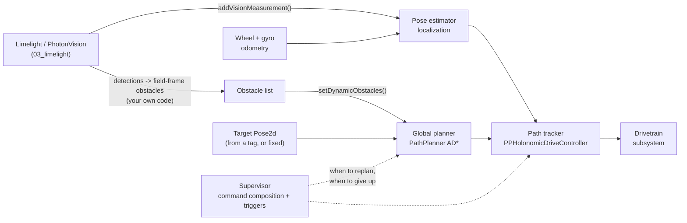

# 09 — The Autonomy Stack in FRC: What Maps, What Doesn't, and What to Build First

> **Where this fits:** [`ml_resources/perception_primer/09-planning-and-av-context.ipynb`](../../ml_resources/perception_primer/09-planning-and-av-context.ipynb)
> and [`10-full-autonomy-stack.ipynb`](../../ml_resources/perception_primer/10-full-autonomy-stack.ipynb)
> build a layered autonomy stack in a Python simulator. This module is the bridge from
> that simulator to a real robot: which FRC tool does each layer's job, what you still
> have to write yourself, and where the simulator quietly assumed something a real robot
> can't. It leans on `03_limelight`, `05_dashboards_and_telemetry`, `06_wpilib`, and
> `08_project_scaffold_and_deploy`, and restates what it needs from each.
>
> *The tool details below were checked against the PathPlanner and WPILib documentation
> in November 2026. Both change between seasons, so treat anything API-shaped as
> something to confirm against the current docs before you build on it.*

## 1. The General Idea

A robot that drives itself toward a goal while the world changes around it is usually
built in layers, because no single algorithm is both far-sighted and fast. A **global
planner** looks far ahead and proposes a route, but it's slow. A **path tracker** turns
that route into steering commands every control cycle. A **reactive layer** keeps the
robot out of trouble moment to moment, whatever the plan says. A **supervisor** watches
the others and decides when the plan can no longer be trusted. Underneath all four sits
**localization** — the robot's estimate of where it is — which every layer silently
depends on.

The catch with learning this in simulation is that a simulator is only as honest as its
assumptions. The notebooks tell the stack the exact position of every robot, assume the
drivetrain does what it's told, and plan for a robot that can't strafe. Those
assumptions make the layers easy to see, and they're also exactly where a real
implementation will bite. Everything below is about finding where those assumptions
stop holding.

## 2. What This Looks Like in FRC

### The map

| Layer | In the notebooks | The FRC counterpart | What you still write yourself |
|---|---|---|---|
| Localization | Assumed perfect | `SwerveDrivePoseEstimator` (odometry) fused with AprilTag vision via `addVisionMeasurement()` | Camera latency, trust tuning, and rejecting bad measurements |
| Global planner | Hybrid A\* (heading-limited robot) or grid A\* | PathPlanner's on-the-fly pathfinding (**AD\*** on a navgrid), or a path drawn ahead of time in PathPlanner or Choreo | The target pose, the obstacle list, and when to ask for a new path |
| Path tracker | Pure Pursuit | `PPHolonomicDriveController` for swerve, `PPLTVController` for differential | Feedforward and PID tuning on your own drivetrain |
| Reactive layer | Potential field | **Nothing standard.** The closest built-in is PathPlanner's dynamic obstacles, which feed the planner rather than act as a reactive layer | All of it |
| Supervisor | Triggers for "blocked" and "stalled" | Command-based composition: commands, triggers, and the scheduler (`06_wpilib`), plus a state machine like `08-decision-making`'s `AutoAlignFSM` | The replan conditions and the fallbacks |
| Prediction | Constant velocity, then multi-hypothesis | **Nothing built in** | All of it |



### Localization: the layer the notebooks skipped

Every layer in the notebooks was handed the robot's exact pose. A real robot has an
estimate, built from wheel and gyro odometry that drifts, corrected by AprilTag
readings that arrive late and sometimes wrong (`04b_motion_control_and_trajectories`
covers the drift, `03_limelight` the tags). WPILib's `SwerveDrivePoseEstimator` is the
Kalman-style fusion of the two, and three details from its documentation matter more
than they look:

- **Latency is your job.** `addVisionMeasurement()` latency-compensates a measurement,
  but on a real robot that latency "must be calculated based either on known latency or
  timestamps." The documentation's own simulation example passes none, and says that's
  for simulation only. This is the notebook's "delayed detections" experiment, except
  now the number has to come from your camera.
- **You tell it how much to trust each source.** The standard deviations you pass in
  decide whether the estimator believes its odometry or the camera. The documentation's
  advice for AprilTag poses is to make the vision *heading* deviation very large (trust
  the gyro for heading), and to scale the vision x/y deviations with distance from the
  tag, since far tags are noisier.
- **One estimate feeds everything.** PathPlanner doesn't know or care whether the pose
  it reads came from pure odometry or fused vision. A bad pose estimate makes a perfect
  planner and tracker drive to the wrong place.

### The global planner: PathPlanner, in two modes

A path **drawn ahead of time** in PathPlanner or Choreo is the notebook's *plan only*
mode: a good plan for the world as it looked when you drew it, with no way to notice
that something changed. PathPlanner's **pathfinding** is the step toward the notebook's
full stack. You hand it a `Pose2d` goal and it plans a path at runtime
(`AutoBuilder.pathfindToPose(targetPose, constraints, goalEndVelocity)`), using AD\* — a
search algorithm in the same family as the A\* from the notebook, built to repair a plan
cheaply when the world changes. A few facts from its documentation shape how you use it:

- **The map is a grid.** Obstacles live in a `navgrid.json` in your project's
  `deploy/pathplanner` folder, the same kind of occupancy grid `09` builds by hand.
- **Moving obstacles are your input.** You supply them as bounding boxes through
  `setDynamicObstacles(obstacles, currentRobotPosition)` (also exposed as a static
  method on `Pathfinding`). PathPlanner doesn't detect anything. Turning a Limelight
  detection into a field-frame box is code you write.
- **It refines in the background.** AD\* produces a first path and then improves it, so
  the documentation warns the robot can occasionally start one way and switch partway
  through when a better route appears. That's the same family of problem as a
  supervisor replanning too eagerly.
- **Heading is hard to control while pathfinding**, which is why the documentation's
  recommended pattern for precise alignment is `AutoBuilder.pathfindThenFollowPath`:
  pathfind to the start of a hand-drawn final approach, then follow it.
- **Practical gotchas:** the first pathfinding run in Java can be noticeably slow
  (`PathfindingCommand.warmupCommand().schedule()` at startup is the documented
  workaround), and AdvantageKit log replay needs its compatible pathfinder
  (`LocalADStarAK`) to work.

### The tracker: not Pure Pursuit

The notebooks use Pure Pursuit because it's the classic algorithm and `04b` builds it.
As `06_wpilib` explains, it's *not* what runs on a swerve robot: PathPlanner uses
`PPHolonomicDriveController`, with per-axis PID, because a robot that can strafe doesn't
need Pure Pursuit's turning-radius trick. So the unicycle sections of `10` teach the
ideas (lookahead, closed-loop correction, why slowing down can reduce steering authority)
but not the code you'd ship on a swerve drivetrain. A differential-drive team does run
into the unicycle's constraints directly, which is where those sections apply most.

### The reactive layer and prediction: where FRC gives you nothing

There's no standard FRC library for a potential field, and none for predicting where
another robot will go. Teams that want either write it. The built-in pieces that come
closest are PathPlanner's dynamic obstacles (which feed the *planner*, not a fast
reactive loop) and the driver override pattern from `08-decision-making`'s safety
override: a human can always take control, which is a reactive layer of a different
kind. Before building either, it's worth asking whether your game and your autonomous
period need it at all (§3).

### The supervisor: command composition

In the notebook the supervisor is a loop with two triggers. In WPILib it's command
composition (`06_wpilib`), and the same shape fits. Here's the idea as a sketch. It's an
illustration of the structure, not a drop-in, so check the current API before copying
anything:

```java
// Drive to a target, but stop and fall back if the plan isn't working out.
Command driveToTarget = AutoBuilder.pathfindToPose(targetPose, constraints, 0.0);

Command guarded = Commands.race(
    driveToTarget,
    new WaitUntilCommand(this::planHasStalled)   // our own condition, from odometry progress
).withTimeout(6.0);                              // never spend longer than this on one attempt

return guarded.andThen(fallbackCommand);         // e.g. hand control to the driver
```

`Commands.race` ends the group when the first member finishes, so the stall condition
interrupts the drive; `withTimeout` is the stall trigger's blunt cousin. The "path is
blocked" trigger from the notebook becomes a fresh call to `setDynamicObstacles` with
updated boxes, and the state machine from `08` (`AutoAlignFSM`) is the natural place to
decide *which* of these commands should be running.

## 3. Where It Diverges From the General Case

**Your own pose is an estimate, and it's the layer everything else trusts.** In the
simulator the robot always knew where it was. On a real robot that estimate is wrong by
some amount that changes with distance from tags, lighting, and whether another robot is
blocking the camera. The most valuable thing to carry out of the notebooks is the
instinct to ask, for any failure, "was the *pose* wrong, or was the layer wrong?"
`05_dashboards_and_telemetry`'s AdvantageScope replay is how you find out after the
fact.

**Most FRC robots are swerve, and the notebook's swerve section is a toy.** It's a point
that can accelerate in any direction. A real swerve robot has module limits, heading
that has to be controlled and finishes in a particular orientation, and constraints
PathPlanner exposes through `PathConstraints` (including angular limits). The notebook's
real lesson about swerve is the structural one: every layer gets simpler, and the
robot gets faster.

**You're not supposed to build the planner.** Hybrid A\* and Dubins paths are in the
notebooks because understanding what the planner does is how you know when to trust it,
not because you'd reimplement it. PathPlanner already ships a planner and a tracker. The
parts that are genuinely yours are the target, the obstacles, the supervisor logic, and
making sure the pose is good.

**The autonomous period is short and rule-bound, and the six-week build season (see
`01_frc_intro`) puts a price on every added feature.** Whether dynamic obstacle
avoidance is worth building depends on the current game manual: what's allowed during
autonomous, whether opponents can be in your way, and how much of the period your
routine uses. Read the manual before the notebook. A routine that scores reliably from a
pre-drawn path will often be worth more than a sophisticated stack that's half tuned.

**The notebook's numbers don't transfer.** Match counts like "29 of 30" came from a
toy simulation with hand-chosen parameters, and they show the *shape* of trade-offs
(prediction helps at the margin, lag is brutal, a Kalman filter rescues noisy
detection), not values to rely on. Your evidence has to come from WPILib simulation
(`06_wpilib`), logs, and the practice field.

### Failures the notebook predicted, and where they show up in PathPlanner

| In the notebook | What it looks like on a real robot |
|---|---|
| Plan only crashed into something that moved | A pre-drawn auto that works in an empty field and fails when a robot is in the way |
| The supervisor replans too eagerly and thrashes | AD\* switching direction partway through a path |
| A robot that can't turn in place needs room to maneuver | PathPlanner's documented warning that a differential drivetrain may need to turn in place before it can follow a pathfound route |
| Slower detections cost matches | Vision measurements fed with the wrong latency, pulling the pose backward |
| Reactive layer unaware of walls | A planner that respects the navgrid while your own avoidance code doesn't |

## 4. A Build Order That Earns Its Complexity

If the goal is a real vision-assisted autonomous mode, build up in this order, and stop
at the first rung that meets the game's needs. Each rung only makes sense once the one
below is solid.

1. **A good pose estimate.** Odometry plus vision, with latency measured and standard
   deviations tuned, checked against known positions on the field (`03_limelight`'s
   pose-accuracy exercise is the template).
2. **A pre-drawn autonomous in simulation, then on the floor.** PathPlanner or Choreo,
   run first in WPILib simulation with Glass (`06_wpilib`), at reduced speed.
3. **A vision-triggered final approach.** The `AutoAlignFSM` pattern from
   `08-decision-making`: detect a tag, compute a target pose, then pathfind to it and
   follow a precise final path.
4. **On-the-fly pathfinding to a vision-derived target**, with only the static navgrid.
5. **Dynamic obstacles**, only if the game demands it. This is where you'd write the
   detection-to-obstacle code, and where the notebook's perception and latency lessons
   apply directly.
6. **Supervisor logic and fallbacks.** What happens if a command doesn't finish, the
   vision pipeline drops out, or the pose jumps? Decide ahead of time, and make the
   fallback "hand control back to the driver."
7. **A reactive layer or prediction**, last, and only with evidence that you need it.

### Before you enable it on a real robot

Test in simulation first. Replay a real log through the same code to see what the
supervisor *would* have done (shadow mode: run it, log its decisions, don't let it drive
yet). Start with conservative `PathConstraints` and raise them as the routine proves
itself. Keep the Driver Station's Disable and E-Stop within reach (`02_driver_station`),
and have the driver override ready. Treat any autonomous that has only passed in
simulation as untested.

## Resources

- [PathPlannerLib: Pathfinding](https://pathplanner.dev/pplib-pathfinding.html) — AD\*, the navgrid, `setDynamicObstacles`, the pathfind-then-follow pattern, and the limitations listed above.
- [PathPlannerLib: Following a Single Path](https://pathplanner.dev/pplib-follow-a-single-path.html) — the holonomic and differential controllers.
- [WPILib: Pose Estimators](https://docs.wpilib.org/en/stable/docs/software/advanced-controls/state-space/state-space-pose-estimators.html) — `addVisionMeasurement()`, latency, and the standard deviations to tune.
- [WPILib: Command Compositions](https://docs.wpilib.org/en/stable/docs/software/commandbased/command-compositions.html) — `race`, `deadline`, and the other pieces a supervisor is built from.
- [`06_wpilib`](../06_wpilib/README.md), [`03_limelight`](../03_limelight/README.md), [`05_dashboards_and_telemetry`](../05_dashboards_and_telemetry/README.md) — the pieces this module connects.
- [`perception_primer/09`](../../ml_resources/perception_primer/09-planning-and-av-context.ipynb) and [`10`](../../ml_resources/perception_primer/10-full-autonomy-stack.ipynb) — the simulator this module is the bridge from.

**Check for understanding / hands-on exercise suggestions:**
- Take the full-stack timeline from `10` and, for each thing the stack did (followed the path, slowed for the opponent, replanned around the gate), name the FRC component that would do it, and say which of them you'd have to write yourself.
- Read PathPlanner's pathfinding page and pick the three limitations that worry you most for your own game. For each, find the matching failure from `09` or `10` and say what the notebook suggests doing about it.
- Write the replan conditions for a robot that has to drive to a scoring pose in autonomous. What are your "blocked" and "stalled" triggers in terms of things you can actually measure, and what does your robot do when both fail?
- Take a pose-estimator log with a few vision measurements and ask: if the camera latency were wrong by 100 ms, what would the pose do while the robot is turning?
